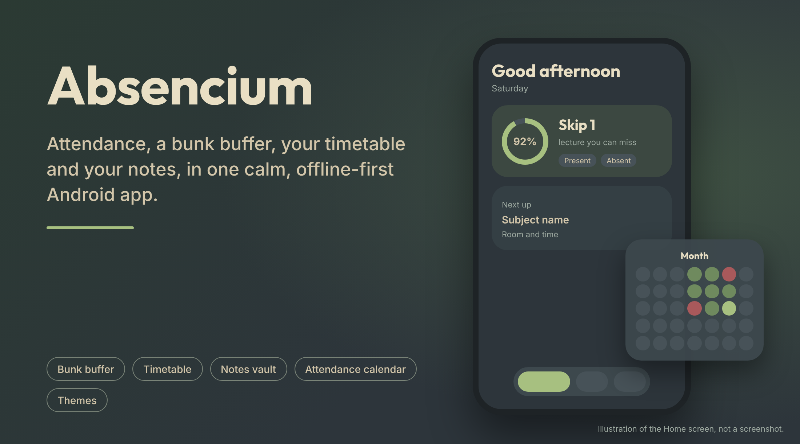
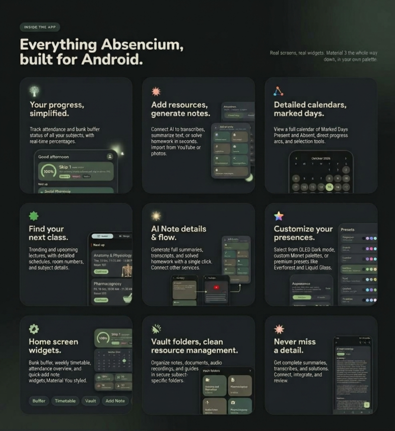
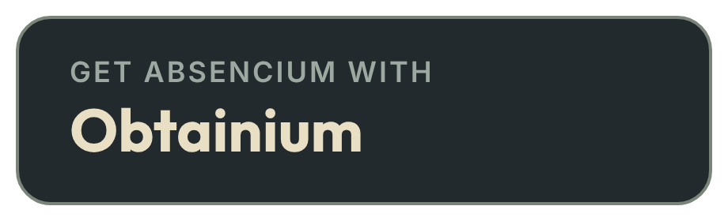

Absencium

  

  <strong>Less academic chaos. More getting your stuff together.</strong>

  A native Android student companion for notes, attendance, assignments, reminders and everything in between.

  
  
  
  

  
  
  

  

Absencium is a student-focused Android app I'm building to make academic life a little less chaotic.

Missed a class? Forgot an assignment? Can't remember where you saved those notes? Yeah, same kind of problems I'm trying to solve.

The idea is to bring your academic essentials together in one place, with a clean native Android interface and a focus on keeping your information under your control.

Built by a student, for students. ☕

> [!NOTE]
Absencium is an independent project and is not affiliated with any educational institution. Features described below may be planned, under development, or available depending on the current build.»

---

---

✨ Features

🏠 Dashboard

A little summary of everything important, helping you keep track of your attendance, upcoming work and academic reminders.

📚 Vault

Keep missed-class notes organized by subject and date. Write your own notes or store photos of notebook pages and study material.

Optional AI-assisted image-to-text tools are part of the broader project vision, where supported and configured.

📊 Attendance

Mark yourself present or absent, review your attendance history and keep an eye on your attendance percentage.

Weekends are treated as holidays in the attendance logic.

⏰ Reminders & Tasks

Keep track of assignments, homework, deadlines and other academic tasks. Set reminders so important dates don't get buried under everything else.

🗓️ Calendar

See upcoming holidays and manage your own holiday list, including unexpected college closures due to weather, strikes or other events.

📝 Drafts

Save unfinished entries and return to them later instead of losing work when leaving the editor.

🎨 Personalization

Make the app feel like yours with custom color schemes, light and dark appearances, and a carefully designed Material 3 Expressive interface.

🪄 Modern Android design

Expressive shapes, pill-shaped navigation, thoughtful animations and a distinctive visual identity inspired by modern Android design.

📱 Offline-first approach

Everyday academic tools should remain useful without requiring a constant internet connection. Optional online features may need connectivity.

---

🎨 Design philosophy

Absencium is built around the idea that a student organizer should feel calm, useful and genuinely nice to use.

- Native Android development with Kotlin and Jetpack Compose.
- Material 3 Expressive-inspired shapes, components and motion.
- A signature pill-based navigation experience.
- Custom themes and carefully chosen color palettes.
- A focus on usability rather than adding features just for the sake of it.

The goal isn't to make another complicated productivity app. It's to make everyday student life easier to manage.

---

📥 Get Absencium

  

  

> [!WARNING]
Download APKs only from this repository or another distribution source explicitly linked by the project. Review release notes before installing updates.»

---

🛠️ Technology

The project architecture is based on the following technologies:

- Kotlin — primary programming language.
- Jetpack Compose — declarative native Android UI.
- Material 3 — UI components and theming.
- Room — local database.
- DataStore — persistent preferences.
- Coroutines & Flow — asynchronous operations and reactive state.
- MVVM and repositories — separation of UI, business logic and data access.

The exact implementation may evolve during development.

---

🔒 Privacy

Your notes, attendance records and academic information are personal.

Absencium is designed with a local-first approach, aiming to keep everyday data on your device without requiring a cloud account.

- No advertising or telemetry is intended.
- No mandatory cloud account is intended.
- Optional AI integrations may communicate with external services when used.
- API keys and other secrets should be handled securely.
- Features that require online services may process the information you choose to send.

Review the documentation and current implementation before using optional integrations with sensitive information.

---

🗺️ Roadmap

The broader vision for Absencium includes:

- [ ] Refine the dashboard and academic overview.
- [ ] Improve subject-based vaults and note management.
- [ ] Complete attendance history and analytics.
- [ ] Improve reminders, assignments and task handling.
- [ ] Expand editable holiday and calendar management.
- [ ] Polish draft saving and restoration.
- [ ] Refine Material 3 Expressive animations and themes.
- [ ] Improve accessibility, reliability and offline behavior.
- [ ] Maintain useful release notes and automated builds.

The roadmap can change as development progresses. Check the repository and releases for current implementation status.

---

🐛 Bugs & feature requests

Found a bug or have an idea that could make student life easier?

"Open an issue on GitHub" (https://github.com/skywa1ker404/Absencium/issues).

Please include enough information to understand the problem, and never post private academic records, API keys or other sensitive information in public issues.

Contributions are welcome when contribution guidelines and the relevant project setup are available.

---

☕ Support the project

I'm a student building apps in my free time. If you like what I'm making, you can support the project with a chai.

"Buy Me a Chai ☕" (https://www.buymeachai.in/skywa1ker404)

No pressure, though. Using the app, reporting bugs, suggesting improvements or starring the repository is already appreciated.

---

📜 License

The applicable license is provided in the ""LICENSE"" (LICENSE) file.

Please check that file before redistributing or modifying the project.

---

The FAQ

Why another student organizer?

Because managing attendance, missed-class notes, deadlines and holidays shouldn't require five different apps. I wanted to build something around the everyday problems students actually deal with.

Is Absencium free?

The project is intended to be freely accessible. Optional third-party services may have their own usage limits or costs.

Does it work offline?

Offline-first behavior is a core design goal. Features that rely on remote services, such as optional AI assistance, need an internet connection.

Will my notes be uploaded to the cloud?

Local storage is the intended default. Optional online integrations may send selected content to external services when you use them. Check the current implementation and documentation for details.

Why isn't it on the Play Store?

I'm focusing on independent development and distribution through GitHub for now. I'll consider other distribution channels when it makes sense.

Will there be an iOS version?

No plans for one. Absencium is staying Android-only so I can focus on building one native app properly.

Can I request a feature?

Absolutely. Open a GitHub issue and explain what problem you're trying to solve. I can't promise every idea will make it in, but useful suggestions are welcome.

Do I need to donate to use Absencium?

Nope. Support is completely optional.

Who's making this?

Just a student building apps, learning along the way and probably having more ideas than free time. ☕
